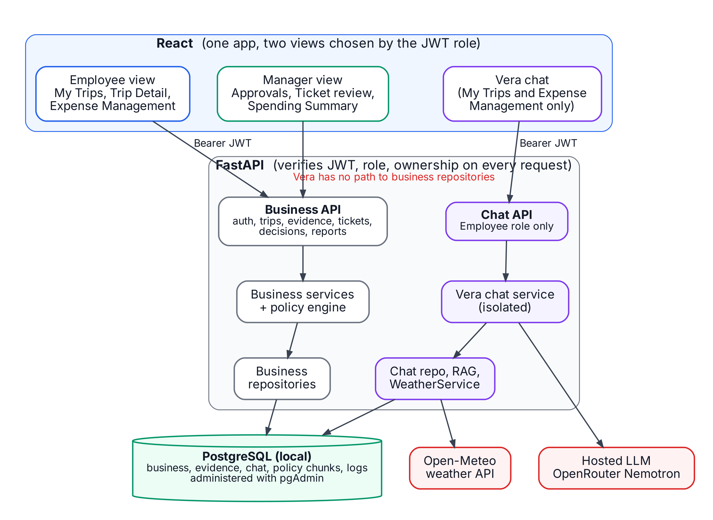

# TravelDesk: AI-Powered Travel & Expense Management

EY AI & Data Capstone, Project 04 (Team 4). The full design is in the [Agile Spec v2.0](docs/agile_spec_link.md).

## Architecture



React (Employee and Manager views, JWT) -> FastAPI (business API + isolated Vera chat API) -> local PostgreSQL (pgAdmin).
Vera uses only expense-policy RAG and the Open-Meteo weather tool, through a hosted LLM (OpenRouter, Nemotron).

## Setup

1. **Database** (each teammate, once): install PostgreSQL + pgAdmin, then in pgAdmin's Query Tool:
   ```sql
   CREATE DATABASE traveldesk;      ALTER DATABASE traveldesk SET timezone = 'Asia/Kolkata';
   CREATE DATABASE traveldesk_test; ALTER DATABASE traveldesk_test SET timezone = 'Asia/Kolkata';
   ```
2. **Backend**
   ```bash
   cd backend
   python -m venv .venv && source .venv/bin/activate      # Windows: .venv\Scripts\activate
   pip install -r requirements.txt
   cp .env.example .env                                   # fill in every placeholder
   python scripts/init_db.py
   python scripts/ingest_policy.py
   uvicorn app.main:app --reload --port 8000              # Swagger: http://localhost:8000/docs
   pytest -q
   ```
3. **Frontend**
   ```bash
   cd frontend && npm install && cp .env.example .env && npm run dev   # http://localhost:5173
   ```

## Example requests

TODO (S5): copy from the spec's API specification and the Postman collection.

## Limitations and changes from the brief

TODO (S5): from the spec's "Changes from the assessment brief" and "Risks, assumptions and limitations".

- **Vera's AI provider:** Vera runs on Google Gemini's free tier (`gemini-3.1-flash-lite`) instead of OpenRouter, because OpenRouter's free models are limited to 50 requests per day per account. Switch back with `AI_PROVIDER=openrouter` in `backend/.env`.
- **Vera latency on the free tier:** the p95 target (< 8 s) is not met reliably. In our runs up to 40% of Gemini calls stalled or returned "overloaded" and were retried automatically. Healthy calls average about 2.3 s, and every eval answer was correct after retries. Settings used: `AI_TIMEOUT_SECONDS=8`, `AI_MAX_RETRIES=2` (spec default: 30 s, 1 retry).
- **Weather card daily table:** `VeraWeatherAnswer` has an extra `days` field (not in Spec v2.0) so the card can show the daily forecast table.
- **Several cities in one question:** `ChatReplyOut` has an extra `weather_cards` list (one card per city, e.g. Rome then Catania); `weather` stays the last card for older clients.
- **Reply length:** Vera's replies may be up to 2,000 characters (spec: 1,200) so two-city forecasts and step-by-step policy answers are not cut off.
- **Rain gear advice:** Vera suggests an umbrella or raincoat only when the rain chance is 20% or more, rain is expected (mm > 0) or it is a rainy day (spec: any chance above 0%, which gave advice like "umbrella - rain chance 2%").
- **Several cities in one question:** Vera gives one answer for the whole trip (an overview, a short section per place, one packing list), written by one AI call within a 20-second budget and checked place by place against the forecast; if the AI is late or wrong, the same layout is built from the data.

## Demo

TODO (S5): the 14 demo steps from the spec.

<!-- ===================== Joyal (M1) added: backend testing section START ===================== -->

## Backend testing guide (business backend, M1)

> Section added by Joyal (M1, business backend). It covers everything in the M1 lane of the Work Distribution:
> database, login and roles, trips, receipt photos, tickets and the policy engine, manager decisions,
> immutability, replacement tickets, reports, error storage, health and the scheduler.
> Vera (chat, RAG, weather) is tested by Piyush's files; the React app by `npm test`.
> All commands are for **Windows PowerShell**; run them from the folder named in each step.

### 0. Words used in this guide

| Word | Meaning |
|---|---|
| Server / backend | The FastAPI program. It must be running for Swagger and the API script to work. |
| Swagger | The page `http://localhost:8000/docs` that lists every endpoint with a **Try it out** button. |
| pgAdmin | The program used to look inside PostgreSQL. |
| Token | A temporary login pass (60 minutes) pasted into Swagger's **Authorize** box. |
| `<TODAY>` | Today's date as `YYYY-MM-DD`. Get it with `Get-Date -Format yyyy-MM-dd`. |
| Status code | 200/201 OK; 401 not logged in; 403 wrong role; 404 not found or not yours; 405 action does not exist; 409 not allowed in the current state; 413/415 photo too big / not a photo; 422 an input is invalid (the answer names the field). |

Every error has the same shape (spec US-04):
`{"error": {"code": "...", "message": "...", "details": [{"field": "...", "msg": "..."}], "request_id": "...", "correlation_id": "...", "retryable": false}}`

### 1. One-time setup

1. **PostgreSQL 16 + pgAdmin 4** installed and running (Start menu > Services > `postgresql-x64-16` > Start, if needed).
2. **Two databases.** pgAdmin > Servers > PostgreSQL 16 > right-click **Databases** > **Query Tool**. Run the four
   lines **one at a time** (highlight one line, press F5); running them together fails with
   "cannot run inside a transaction block":
   ```sql
   CREATE DATABASE traveldesk;
   CREATE DATABASE traveldesk_test;
   ALTER DATABASE traveldesk SET timezone = 'Asia/Kolkata';
   ALTER DATABASE traveldesk_test SET timezone = 'Asia/Kolkata';
   ```
3. **Python 3.14** and the packages (from `traveldesk\backend`):
   ```powershell
   python --version                    # Python 3.14.x
   pip install -r requirements.txt
   ```
4. **Private settings.** `Copy-Item .env.example .env`, then edit `backend\.env` (never commit or share it):
   - `DATABASE_URL=postgresql+psycopg://postgres:<password>@localhost:5432/traveldesk`
   - `TEST_DATABASE_URL=postgresql+psycopg://postgres:<password>@localhost:5432/traveldesk_test`
     (write `@` in the password as `%40`, `#` as `%23`)
   - `JWT_SECRET_KEY=` the team secret (32+ characters, shared privately; never `change-me-...`)
   - `SEED_DEMO_PASSWORD=` any password of 8+ characters (all demo users log in with it)

### 2. Build the databases

From `traveldesk\backend`:
```powershell
python scripts\init_db.py                     # real/demo database
python scripts\init_db.py --test-database     # practice database (pytest also does this itself)
```
Expected the first time:
```
Applied migrations: 001_core_tables.sql, 002_expense_tables.sql, 003_chat_rag_tables.sql, 004_log_tables.sql, 005_indexes.sql, 006_integrity_triggers.sql
Seed data loaded.
```
Running it again is safe: `No new migrations to apply.` and `Seed skipped: employees already exist.`

| Possible message | Fix |
|---|---|
| `Set a private SEED_DEMO_PASSWORD of at least 8 characters` | Fix `.env` (step 1.4). |
| `password authentication failed` / `could not translate host name` | Wrong DB password, or `@` not written as `%40`. |
| `relation "employees" already exists` | The database was built by hand earlier: delete it (step 9) and rebuild. |
| `Cannot apply migrations because these files are empty placeholders` | A migration file is empty; pull the latest branch. |

**Demo data after a fresh build** (password for everyone = your `SEED_DEMO_PASSWORD`):

| Person (id) | Email | Role |
|---|---|---|
| Vikram Iyer (1) | `vikram.iyer@veridian.example` | MANAGER of the other three |
| Ananya Rao (2) | `ananya.rao@veridian.example` | EMPLOYEE |
| Rohan Mehta (3) | `rohan.mehta@veridian.example` | EMPLOYEE |
| Sara Thomas (4) | `sara.thomas@veridian.example` | EMPLOYEE |

| Trip (id) | Owner | City / dates | Status |
|---|---|---|---|
| TRP-00001 (1) | Ananya | Mumbai, ended 17 days ago | Approved - Active (manager can complete it) |
| TRP-00002 (2) | Rohan | Bengaluru, in 3-6 days, created 5 days ago | Approved - Active |
| TRP-00003 (3) | Sara | Singapore, in 40-44 days | Approved - Active |
| TRP-00004 (4) | Rohan | Jaipur, in 20-22 days | In Progress |

Tickets: TKT-00001 AUTO_APPROVED, TKT-00002 APPROVED, TKT-00003 **PENDING** (airfare 24,500 over the 20,000
threshold), TKT-00004 **REJECTED** (historical demo record for the replacement flow), TKT-00005 AUTO_APPROVED.

### 3. Shortcut A: automatic tests (no server needed, ~4 minutes)

From `traveldesk\backend`:
```powershell
python -m pytest -q                              # expected: 169 passed, 5 skipped
python -m pytest -q tests\test_ticket_service.py # one file
python -m pytest -q -k replacement               # tests whose name contains a word
python -m pytest -q -x                           # stop at the first failure
```
The 5 skipped files are Vera tests (M2). Tests use only `traveldesk_test` and leave it empty afterwards.
The `langsmith ... asyncio.iscoroutinefunction is deprecated` warnings come from a third-party AI library and are harmless.

| Test file | What it proves |
|---|---|
| `test_schemas.py` | Every input rule: trip dates, destination, amounts, categories, future expense date, photo required, same photo/invoice twice, decision comments, login email/password |
| `test_auth.py` | Login, the same 401 for any wrong login (also a short password), expired and tampered tokens, role re-read from the database |
| `test_rbac.py` | Every route: no token -> 401, wrong role -> 403 |
| `test_trip_service.py` | US-05..09: create, My Trips filters, detail access, edit only In Progress, approve/reject with comment, 90-day approval window, manager completion, automatic completion |
| `test_evidence.py` | US-10: JPEG/PNG/WEBP accepted, renamed PDF 415, over 5 MB 413, exactly 5 MB accepted, who may view, 405, 24-hour clean-up job |
| `test_ticket_service.py` | US-11/13/18: auto-approval, pending routing, only on Active trips, ticket-time auto-complete, expense date before trip creation (422 on the right line), missing photo, other person's photo 404, reused photo 409, rollback, permissions, policy re-check |
| `test_policy_engine.py` | US-12: thresholds below / equal / above for all five categories, duplicates by photo and by invoice, rejected tickets ignored, routing |
| `test_manager_comment.py` | US-14: reason and comment rules for ticket decisions |
| `test_ticket_immutability.py` | US-15: second decision 409, PUT/PATCH/DELETE 405, database triggers refuse changes |
| `test_replacement.py` | US-16: new ids, original unchanged, only once, own rejected ticket on the same trip, not on a completed trip |
| `test_reports_sql.py` | US-17: the three SQL demonstrations match the seed exactly |
| `test_logging.py` (`TestErrorLogs`) | US-04: an `error_logs` row for every error, ids, no secrets, stack trace only for 5xx, JSON-log fallback |
| `test_api_flows.py` | Full journey, data survives a restart, business works with AI/weather down, `/health` |

### 4. Start the server

From `traveldesk\backend` (keep this window open):
```powershell
python -m uvicorn app.main:app --reload --port 8000
```
Expected: `Application startup complete.` and a JSON line with `"event": "scheduled_jobs_run"` (the hourly
background job ran once at startup). Every error later appears in this window as one JSON line.
Swagger: open **http://localhost:8000/docs** in a browser.

> Steps 5-8 change the demo data in `traveldesk`. Rebuild it (step 9) before a real demo or before
> running the shortcut script again.

### 5. Shortcut B: end-to-end API script (55 checks, ~1 minute)

Needs: a freshly built `traveldesk` (step 9 then step 2) and the server running (step 4).
Open a **second** PowerShell window, go to the repository root (`traveldesk`, the folder that contains
`backend` and `database`), paste the whole block below, press Enter and type the `SEED_DEMO_PASSWORD` when asked.
Each check prints **PASS** or **FAIL**; the last line must be `RESULT: 55 passed, 0 failed`.

<details>
<summary>PowerShell script (click to expand)</summary>

```powershell
$base = "http://localhost:8000/api/v1"
$sec = Read-Host "Type your SEED_DEMO_PASSWORD (hidden)" -AsSecureString
$pw = [System.Net.NetworkCredential]::new("", $sec).Password
$seedPhotos = Join-Path (Get-Location) "database\seed\evidence"
$today = (Get-Date).ToString("yyyy-MM-dd")
$script:pass = 0; $script:fail = 0
function Invoke-Api($method, $path, $token = $null, $body = $null, $extra = @{}) {
    $headers = @{} + $extra
    if ($token) { $headers["Authorization"] = "Bearer $token" }
    $p = @{ Method = $method; Uri = "$base$path"; Headers = $headers; UseBasicParsing = $true }
    if ($null -ne $body) { $p.Body = (ConvertTo-Json -InputObject $body -Depth 10); $p.ContentType = "application/json" }
    try { $r = Invoke-WebRequest @p; $status = [int]$r.StatusCode; $content = $r.Content }
    catch { $status = [int]$_.Exception.Response.StatusCode; $content = $_.ErrorDetails.Message }
    $parsed = $null
    if ($content -is [string] -and $content) { try { $parsed = $content | ConvertFrom-Json } catch { $parsed = $content } }
    [pscustomobject]@{ Status = $status; Body = $parsed }
}
function Upload-Photo($token, $file) {
    $out = [IO.Path]::GetTempFileName()
    $code = curl.exe -s -o $out -w "%{http_code}" -H "Authorization: Bearer $token" -F "file=@$file" "$base/evidence"
    $raw = Get-Content $out -Raw; Remove-Item $out
    [pscustomobject]@{ Status = [int]$code; Body = ($raw | ConvertFrom-Json) }
}
function Check($name, [bool]$ok) {
    if ($ok) { $script:pass++; Write-Host "PASS  $name" -ForegroundColor Green }
    else { $script:fail++; Write-Host "FAIL  $name" -ForegroundColor Red }
}
function Login($email) { (Invoke-Api POST "/auth/login" $null @{ email = $email; password = $pw }).Body.access_token }
function Line($evidenceId, $amount, $type = "MEALS", $date = $today) {
    @{ expense_type = $type; amount = $amount; expense_date = $date; description = "Client meeting expense"; evidence_id = $evidenceId }
}
# 1. Health and login
$r = Invoke-Api GET "/health"; Check "health public, database ok" ($r.Status -eq 200 -and $r.Body.dependencies[0].ok)
$rohan = Login "rohan.mehta@veridian.example"; $vikram = Login "vikram.iyer@veridian.example"
$ananya = Login "ananya.rao@veridian.example"; $sara = Login "sara.thomas@veridian.example"
Check "4 demo users log in" ($rohan -and $vikram -and $ananya -and $sara)
$r = Invoke-Api POST "/auth/login" $null @{ email = "rohan.mehta@veridian.example"; password = "WrongPass123" }
Check "wrong password -> 401 INVALID_CREDENTIALS" ($r.Status -eq 401 -and $r.Body.error.code -eq "INVALID_CREDENTIALS")
$r = Invoke-Api POST "/auth/login" $null @{ email = "nobody@veridian.example"; password = "WrongPass123" }
Check "unknown email -> same 401" ($r.Status -eq 401 -and $r.Body.error.message -eq "Email or password is incorrect.")
Check "short password -> same 401" ((Invoke-Api POST "/auth/login" $null @{ email = "rohan.mehta@veridian.example"; password = "abc" }).Status -eq 401)
Check "/me -> Rohan EMPLOYEE" ((Invoke-Api GET "/me" $rohan).Body.role -eq "EMPLOYEE")
Check "/me without token -> 401 UNAUTHENTICATED" ((Invoke-Api GET "/me").Body.error.code -eq "UNAUTHENTICATED")
Check "/me tampered token -> 401 INVALID_TOKEN" ((Invoke-Api GET "/me" ($rohan + "x")).Body.error.code -eq "INVALID_TOKEN")
# 2. Trips
$r = Invoke-Api GET "/trips?when=upcoming" $rohan
Check "upcoming = TRP-00002,TRP-00004" ((@($r.Body | ForEach-Object trip_code) -join ",") -eq "TRP-00002,TRP-00004")
Check "past = none" (@((Invoke-Api GET "/trips?when=past" $rohan).Body).Count -eq 0)
Check "someone else's trip -> 404" ((Invoke-Api GET "/trips/1" $rohan).Status -eq 404)
$tripBody = @{ destination = "Hyderabad"; start_date = (Get-Date).AddDays(7).ToString("yyyy-MM-dd"); end_date = (Get-Date).AddDays(9).ToString("yyyy-MM-dd"); purpose = "Client workshop for FY27 audit planning" }
$r = Invoke-Api POST "/trips" $rohan $tripBody
Check "create trip -> 201 In Progress" ($r.Status -eq 201 -and $r.Body.status_label -eq "In Progress"); $newTrip = $r.Body.trip_id
$bad = $tripBody.Clone(); $bad.end_date = $bad.start_date; $r = Invoke-Api POST "/trips" $rohan $bad
Check "end = start -> 422 under end_date" ($r.Status -eq 422 -and $r.Body.error.details[0].field -eq "end_date")
$bad = $tripBody.Clone(); $bad.employee_id = 2
Check "employee_id in body -> 422" ((Invoke-Api POST "/trips" $rohan $bad).Status -eq 422)
Check "manager creates trip -> 403" ((Invoke-Api POST "/trips" $vikram $tripBody).Status -eq 403)
$edit = $tripBody.Clone(); $edit.purpose = "Client workshop and audit planning"
Check "edit In Progress trip -> 200" ((Invoke-Api PUT "/trips/$newTrip" $rohan $edit).Status -eq 200)
Check "edit approved trip -> 409 TRIP_NOT_EDITABLE" ((Invoke-Api PUT "/trips/2" $rohan $edit).Body.error.code -eq "TRIP_NOT_EDITABLE")
# 3. Trip decisions
$ids = @((Invoke-Api GET "/trips/pending" $vikram).Body | ForEach-Object trip_id)
Check "pending queue has TRP-00004 and the new trip" (($ids -contains 4) -and ($ids -contains $newTrip))
$r = Invoke-Api POST "/trips/4/decision" $vikram @{ decision = "REJECTED" }
Check "reject without comment -> 422 review_comment" ($r.Status -eq 422 -and $r.Body.error.details[0].field -eq "review_comment")
Check "reject with comment -> Rejected" ((Invoke-Api POST "/trips/4/decision" $vikram @{ decision = "REJECTED"; review_comment = "Budget is frozen this quarter." }).Body.status_label -eq "Rejected")
Check "approve -> Approved - Active" ((Invoke-Api POST "/trips/$newTrip/decision" $vikram @{ decision = "APPROVED" }).Body.status_label -eq "Approved - Active")
Check "second decision -> 409 ALREADY_DECIDED" ((Invoke-Api POST "/trips/$newTrip/decision" $vikram @{ decision = "APPROVED" }).Body.error.code -eq "ALREADY_DECIDED")
Check "employee on decision route -> 403" ((Invoke-Api POST "/trips/4/decision" $rohan @{ decision = "APPROVED" }).Status -eq 403)
# 4. Photos and tickets
$p1 = Upload-Photo $rohan "$seedPhotos\evd_00001.jpg"
Check "upload JPEG -> 201 EVD code" ($p1.Status -eq 201 -and $p1.Body.evidence_code -like "EVD-*")
$fake = Join-Path $env:TEMP "fake_receipt.jpg"; Set-Content -Path $fake -Value "%PDF-1.7 not an image" -NoNewline
Check "renamed PDF -> 415" ((Upload-Photo $rohan $fake).Status -eq 415)
Check "manager upload -> 403" ((Upload-Photo $vikram "$seedPhotos\evd_00001.jpg").Status -eq 403)
$r = Invoke-Api POST "/trips/2/tickets" $rohan @{ expenses = @((Line $p1.Body.evidence_id 800)) }
Check "clean ticket -> 201 AUTO_APPROVED by SYSTEM" ($r.Status -eq 201 -and $r.Body.status -eq "AUTO_APPROVED" -and $r.Body.history[0].reviewer_name -eq "SYSTEM")
$p2 = Upload-Photo $rohan "$seedPhotos\evd_00002.jpg"
$r = Invoke-Api POST "/trips/2/tickets" $rohan @{ expenses = @((Line $p2.Body.evidence_id 1800)) }
Check "MEALS 1800 -> PENDING with OVER_THRESHOLD" ($r.Body.status -eq "PENDING" -and $r.Body.expenses[0].flags[0].rule_code -eq "OVER_THRESHOLD"); $flagged = $r.Body
$p3 = Upload-Photo $rohan "$seedPhotos\evd_00003.jpg"
$r = Invoke-Api POST "/trips/2/tickets" $rohan @{ expenses = @((Line $p3.Body.evidence_id 500 "MEALS" (Get-Date).AddDays(-10).ToString("yyyy-MM-dd"))) }
Check "date before trip created -> 422 on expenses.0.expense_date" ($r.Body.error.code -eq "EXPENSE_DATE_BEFORE_TRIP_CREATED" -and $r.Body.error.details[0].field -eq "expenses.0.expense_date")
Check "reused photo -> 409 EVIDENCE_ALREADY_USED" ((Invoke-Api POST "/trips/2/tickets" $rohan @{ expenses = @((Line $p1.Body.evidence_id 300)) }).Body.error.code -eq "EVIDENCE_ALREADY_USED")
Check "ticket on rejected trip -> 409 TRIP_NOT_ACTIVE" ((Invoke-Api POST "/trips/4/tickets" $rohan @{ expenses = @((Line $p3.Body.evidence_id 300)) }).Body.error.code -eq "TRIP_NOT_ACTIVE")
Check "policy rules: MEALS threshold 1500" ((Invoke-Api GET "/policy/rules" $rohan).Body.review_thresholds_inr.MEALS -eq 1500)
Check "my pending tickets include TKT-00003" (@((Invoke-Api GET "/tickets?status=PENDING" $rohan).Body | ForEach-Object ticket_code) -contains "TKT-00003")
$r = Invoke-Api GET ("/expenses/" + $flagged.expenses[0].expense_id + "/policy-check") $rohan
Check "policy re-check -> OVER_THRESHOLD" ($r.Body.requires_manager_review -and $r.Body.flags[0].rule_code -eq "OVER_THRESHOLD")
# 5. Ticket decisions
$ids = @((Invoke-Api GET "/tickets/pending" $vikram).Body | ForEach-Object ticket_id)
Check "manager queue has TKT-00003 and the 1800 ticket" (($ids -contains 3) -and ($ids -contains $flagged.ticket_id))
Check "approve TKT-00003 with comment" ((Invoke-Api POST "/tickets/3/decision" $vikram @{ decision = "APPROVED"; review_comment = "Fare checked against the booking." }).Body.status -eq "APPROVED")
Check "second ticket decision -> 409" ((Invoke-Api POST "/tickets/3/decision" $vikram @{ decision = "APPROVED" }).Status -eq 409)
$r = Invoke-Api POST ("/tickets/" + $flagged.ticket_id + "/decision") $vikram @{ decision = "REJECTED"; review_comment = "Please attach the itemised bill." }
Check "reject without reason -> 422 rejection_reason" ($r.Status -eq 422 -and $r.Body.error.details[0].field -eq "rejection_reason")
$r = Invoke-Api POST ("/tickets/" + $flagged.ticket_id + "/decision") $vikram @{ decision = "REJECTED"; rejection_reason = "OTHER"; review_comment = "Please attach the itemised bill." }
Check "reject with reason + comment -> REJECTED read-only" ($r.Body.status -eq "REJECTED" -and $r.Body.is_read_only)
Check "manager views the photo -> 200" ((Invoke-Api GET ("/evidence/" + $p1.Body.evidence_id + "/file") $vikram).Status -eq 200)
Check "colleague views the photo -> 404" ((Invoke-Api GET ("/evidence/" + $p1.Body.evidence_id + "/file") $sara).Status -eq 404)
Check "DELETE a ticket -> 405" ((Invoke-Api DELETE "/tickets/1" $vikram).Status -eq 405)
# 6. Replacement
$r = Invoke-Api POST "/trips/2/tickets" $rohan @{ replacement_of_ticket_id = 4; expenses = @((Line $p3.Body.evidence_id 4200 "AIRFARE")) }
Check "replacement for TKT-00004 -> 201" ($r.Status -eq 201 -and $r.Body.replacement_of_ticket_code -eq "TKT-00004")
$r = Invoke-Api GET "/tickets/4" $rohan
Check "TKT-00004 unchanged, replaced_by filled" ($r.Body.status -eq "REJECTED" -and $r.Body.replaced_by_ticket_code)
$p4 = Upload-Photo $rohan "$seedPhotos\evd_00004.jpg"
Check "second replacement -> 409 REPLACEMENT_NOT_ALLOWED" ((Invoke-Api POST "/trips/2/tickets" $rohan @{ replacement_of_ticket_id = 4; expenses = @((Line $p4.Body.evidence_id 4200 "AIRFARE")) }).Body.error.code -eq "REPLACEMENT_NOT_ALLOWED")
# 7. Completion
Check "trips to complete = TRP-00001" ((@((Invoke-Api GET "/trips/to-complete" $vikram).Body | ForEach-Object trip_code) -join ",") -eq "TRP-00001")
Check "complete before end date -> 409 TRIP_NOT_FINISHED" ((Invoke-Api POST "/trips/2/complete" $vikram).Body.error.code -eq "TRIP_NOT_FINISHED")
Check "employee completes -> 403" ((Invoke-Api POST "/trips/1/complete" $ananya).Status -eq 403)
$r = Invoke-Api POST "/trips/1/complete" $vikram
Check "manager completes TRP-00001" ($r.Body.trip_state -eq "COMPLETED" -and $r.Body.completion_type -eq "MANAGER")
$pa = Upload-Photo $ananya "$seedPhotos\evd_00006.jpg"
Check "ticket on completed trip -> 409 TRIP_NOT_ACTIVE" ((Invoke-Api POST "/trips/1/tickets" $ananya @{ expenses = @((Line $pa.Body.evidence_id 300)) }).Body.error.code -eq "TRIP_NOT_ACTIVE")
# 8. Reports and tracing
Check "report 1 has the 8 demo lines + new ones" (@((Invoke-Api GET "/reports/trip-expenses" $vikram).Body).Count -ge 8)
Check "report 2 has trip total rows" (@((Invoke-Api GET "/reports/spend-by-trip-category" $vikram).Body | Where-Object { $null -eq $_.expense_type }).Count -ge 1)
Check "report 3 answers 200" ((Invoke-Api GET "/expenses/pending" $vikram).Status -eq 200)
Check "employee on reports -> 403" ((Invoke-Api GET "/reports/trip-expenses" $rohan).Status -eq 403)
$r = Invoke-Api GET "/nope" $null $null @{ "X-Correlation-ID" = "guide-test-123" }
Check "404 envelope echoes the correlation id" ($r.Status -eq 404 -and $r.Body.error.correlation_id -eq "guide-test-123")
Write-Host "`nRESULT: $script:pass passed, $script:fail failed" -ForegroundColor Yellow
```
</details>

### 6. Full Swagger walk-through (every case, by hand)

**How to use Swagger:** click an endpoint bar > **Try it out** > fill the fields or edit the **Request body** >
**Execute** > read **Server response** (Code + Response body).
**Login in Swagger:** run `POST /api/v1/auth/login`, copy the `access_token` value (without quotes), click the green
**Authorize** button (top right), paste **only the token** (Swagger adds "Bearer"), **Authorize** > **Close**.
To switch user: **Authorize** > **Logout**, then log in as the other person. Tokens last 60 minutes
(`401 TOKEN_EXPIRED` = log in again). Ids below assume a fresh build; always use the id shown in **your** response.

#### 6.1 Health and login (US-02, US-03)
| # | Endpoint and input | Expected |
|---|---|---|
| 1 | `GET /api/v1/health` (no login) | 200 `{"status":"ok","dependencies":[{"name":"database","ok":true}]}` |
| 2 | `POST /api/v1/auth/login` `{"email":"rohan.mehta@veridian.example","password":"<SEED_DEMO_PASSWORD>"}` | 200 `access_token`, `token_type` bearer, `expires_in` 3600, user Rohan, role EMPLOYEE, manager_id 1 |
| 3 | same, `"password":"WrongPass123"` | 401 `INVALID_CREDENTIALS` "Email or password is incorrect." |
| 4 | `"email":"nobody@veridian.example"` | the **same** 401 (nobody can learn which emails exist) |
| 5 | Rohan's email, `"password":"abc"` | the **same** 401 (no password-length hint) |
| 6 | `"email":"rohan"` | 422, field `email`, "Enter a valid email address" |
| 7 | `"password":""` | 422, field `password` |
| 8 | Rohan's email in capitals, correct password | 200 (email is not case-sensitive) |
| 9 | Authorize as Rohan, `GET /api/v1/me` | 200 Rohan, EMPLOYEE |
| 10 | Logout, `GET /api/v1/me` | 401 `UNAUTHENTICATED` (then Authorize as Rohan again) |

#### 6.2 Trips as Rohan (US-05, US-06, US-07)
| # | Endpoint and input | Expected |
|---|---|---|
| 1 | `GET /api/v1/trips`, `when` = upcoming | TRP-00002 then TRP-00004, with `status_label`, `auto_complete_on`, `ticket_count`, `total_claimed` |
| 2 | `when` = past / all | `[]` / both trips |
| 3 | `GET /api/v1/trips/{trip_id}` = 1 (Ananya's) or 999 | 404 `NOT_FOUND` (ids cannot be probed) |
| 4 | `trip_id` = 2 | 200: approvals (Vikram APPROVED), tickets TKT-00003 + TKT-00004, `can_raise_ticket` true, `can_edit` false |
| 5 | `POST /api/v1/trips` `{"destination":"Hyderabad","start_date":"<TODAY+7>","end_date":"<TODAY+9>","purpose":"Client workshop for FY27 audit planning"}` | 201 TRP-00005, In Progress, `earliest_expense_date` = today, `auto_complete_on` = start + 90, `can_edit` true |
| 6 | `end_date` = `start_date` | 422 field `end_date` |
| 7 | `start_date` = yesterday | 422 field `start_date` |
| 8 | `end_date` = start + 31 days | 422 field `end_date` ("at most 30 days") |
| 9 | `start_date` = today + 400 | 422 field `start_date` ("more than one year") |
| 10 | `"destination":"H1"` / `"purpose":"short"` | 422 field `destination` / `purpose` |
| 11 | add `"employee_id": 2` | 422 field `employee_id` (cannot create for someone else) |
| 12 | start = today, end = today + 29 (exactly 30 days) | 201 (limits are inclusive) |
| 13 | `PUT /api/v1/trips/5` with a new purpose | 200 |
| 14 | `PUT /api/v1/trips/2` | 409 `TRIP_NOT_EDITABLE`; `PUT /trips/1` -> 404 |
| 15 | `GET /api/v1/trips/pending`, `POST /api/v1/trips/1/complete` | 403 `FORBIDDEN` (manager actions) |

#### 6.3 Receipt photos and tickets as Rohan (US-10 .. US-13, US-18)
Photos for testing: `database\seed\evidence\evd_00001.jpg` .. `evd_00004.jpg` (they belong to Ananya in the demo
data, so they are not duplicates for Rohan). A fake photo: in PowerShell
`Set-Content -Path "$HOME\Desktop\fake_receipt.jpg" -Value "%PDF-1.7 not an image" -NoNewline`.

| # | Endpoint and input | Expected |
|---|---|---|
| 1 | `GET /api/v1/policy/rules` | thresholds AIRFARE 20000, LODGING 7500, MEALS 1500, GROUND_TRANSPORT 3000, INCIDENTALS 1000; cap 200000; 5242880 bytes |
| 2 | `POST /api/v1/evidence` > Choose File `evd_00001.jpg` | 201 `EVD-00009`, `image/jpeg`, `sha256`; copy `evidence_id` = PHOTO-1 |
| 3 | upload `fake_receipt.jpg` | 415 `EVIDENCE_INVALID_FILE` (the file's first bytes are checked, not its name) |
| 4 | upload a file over 5 MB | 413 `EVIDENCE_TOO_LARGE` |
| 5 | `POST /api/v1/trips/2/tickets` `{"expenses":[{"expense_type":"MEALS","amount":800,"expense_date":"<TODAY>","description":"Team lunch with client","evidence_id":"<PHOTO-1>"}]}` | 201 TKT-00006 `AUTO_APPROVED`, routing AUTO, EXP-00009, no flags, history SYSTEM |
| 6 | upload `evd_00002.jpg` (PHOTO-2); same body, amount 1800 | 201 TKT-00007 `PENDING`, routing MANAGER, flag `OVER_THRESHOLD` "MEALS amount 1,800.00 is above the 1,500.00 review threshold" `[POL-6.2]` |
| 7 | upload `evd_00003.jpg` (PHOTO-3); `expense_date` = today - 10 | 422 `EXPENSE_DATE_BEFORE_TRIP_CREATED`, field `expenses.0.expense_date` "Must be on or after <created date>"; nothing saved |
| 8 | remove `evidence_id` from the line | 422 field `expenses.0.evidence_id` (brief's "missing receipt": refused) |
| 9 | PHOTO-1 again | 409 `EVIDENCE_ALREADY_USED` |
| 10 | amount 0 / 200001 / type `SHOPPING` / future date | 422 on `expenses.0.amount` / `amount` / `expense_type` / `expense_date` |
| 11 | the same photo on two lines; `"expenses": []` | 422 field `expenses`; 422 |
| 12 | `POST /api/v1/trips/4/tickets` (In Progress trip) / `trips/1/tickets` (Ananya's) | 409 `TRIP_NOT_ACTIVE` / 404 |
| 13 | `GET /api/v1/tickets`, `status` = PENDING | TKT-00003 and TKT-00007 |
| 14 | `GET /api/v1/tickets/6` | lines with EXP and EVD codes, history SYSTEM, `is_read_only` true |
| 15 | `GET /api/v1/trips/2/expenses`, then `GET /api/v1/expenses/{id}/policy-check` for the 1800 line | flags OVER_THRESHOLD, `requires_manager_review` true, `rules_version` "VGS-FIN-TE-001 v2.0" (read-only) |

#### 6.4 Manager decisions as Vikram (US-08, US-14, US-15)
| # | Endpoint and input | Expected |
|---|---|---|
| 1 | Logout, log in as `vikram.iyer@veridian.example`, Authorize; `GET /api/v1/me` | role MANAGER |
| 2 | `GET /api/v1/trips/pending` | TRP-00004 and TRP-00005 |
| 3 | `POST /api/v1/trips/4/decision` `{"decision":"REJECTED"}` | 422 field `review_comment` (10+ characters needed) |
| 4 | `{"decision":"REJECTED","review_comment":"Budget is frozen this quarter."}` | 200 Rejected |
| 5 | `POST /api/v1/trips/5/decision` `{"decision":"APPROVED"}`, then again | 200 Approved - Active, then 409 `ALREADY_DECIDED` |
| 6 | `GET /api/v1/tickets/pending` | TKT-00003 and TKT-00007, each with `flag_codes` ["OVER_THRESHOLD"] |
| 7 | `GET /api/v1/evidence/{PHOTO-1}/file` | 200, the image is shown |
| 8 | `POST /api/v1/tickets/3/decision` `{"decision":"APPROVED","review_comment":"Fare checked against the booking."}`, then again | 200 APPROVED with the comment in history, then 409 |
| 9 | `POST /api/v1/tickets/7/decision` without `rejection_reason` | 422 field `rejection_reason` |
| 10 | with `"rejection_reason":"OTHER","review_comment":"Too short"` | 422 field `review_comment` |
| 11 | `{"decision":"APPROVED","rejection_reason":"OTHER"}` | 422 field `rejection_reason` |
| 12 | `{"decision":"REJECTED","rejection_reason":"OTHER","review_comment":"Please attach the itemised bill."}` | 200 REJECTED, `is_read_only` true, lines REJECTED |
| 13 | `POST /api/v1/trips` or `POST /api/v1/evidence` as Vikram | 403 (employee actions) |

Rejection reasons: `MISSING_EVIDENCE`, `INSUFFICIENT_EVIDENCE`, `INCORRECT_EVIDENCE`, `UNCLEAR_PURPOSE`, `POLICY_CONCERN`, `OTHER`.

#### 6.5 Replacement ticket as Rohan (US-16)
| # | Endpoint and input | Expected |
|---|---|---|
| 1 | `POST /api/v1/trips/2/tickets` `{"replacement_of_ticket_id":4,"expenses":[{"expense_type":"AIRFARE","amount":4200,"expense_date":"<TODAY>","description":"Extra baggage","evidence_id":"<PHOTO-3>"}]}` | 201 TKT-00008, `replacement_of_ticket_code` TKT-00004, new EXP/EVD ids, AUTO_APPROVED |
| 2 | `GET /api/v1/tickets/4` | still REJECTED with the old comment, `replaced_by_ticket_code` TKT-00008, `can_create_replacement` false |
| 3 | repeat #1 with a new photo | 409 `REPLACEMENT_NOT_ALLOWED` (only once) |
| 4 | `replacement_of_ticket_id` = 3 (not rejected) | 409 `REPLACEMENT_NOT_ALLOWED` |

#### 6.6 Completion (US-09), privacy, reports (US-17), read-only (US-15)
| # | Who / endpoint | Expected |
|---|---|---|
| 1 | Vikram: `GET /api/v1/trips/to-complete` | TRP-00001 |
| 2 | Vikram: `POST /api/v1/trips/2/complete` / `trips/4/complete` | 409 `TRIP_NOT_FINISHED` / 409 `TRIP_NOT_ACTIVE` |
| 3 | Vikram: `POST /api/v1/trips/1/complete` | 200 Approved - Completed, `completion_type` MANAGER, `completed_by_name` Vikram Iyer |
| 4 | Ananya: upload a photo, `POST /api/v1/trips/1/tickets` | 409 `TRIP_NOT_ACTIVE` (no tickets after completion) |
| 5 | Ananya: `GET /api/v1/evidence/{PHOTO-1}/file` | 404 `EVIDENCE_NOT_FOUND` (only the uploader and their manager) |
| 6 | Vikram: `GET /api/v1/reports/trip-expenses` | every line with employee, trip, destination, type, amount, status |
| 7 | Vikram: `GET /api/v1/reports/spend-by-trip-category` | approved money per trip and category; rows with `expense_type` null are trip totals (fresh demo data: TRP-00001 17,500, TRP-00003 18,000) |
| 8 | Vikram: `GET /api/v1/expenses/pending` | flagged lines in pending tickets |
| 9 | Rohan: any report | 403 |
| 10 | PowerShell: `curl.exe -s -X DELETE http://localhost:8000/api/v1/tickets/1` | 405 `METHOD_NOT_ALLOWED` (no edit/delete of tickets, expenses, photos or decisions) |

### 7. Check the database in pgAdmin

Right-click **traveldesk** > **Query Tool**, paste one query, press F5.
```sql
SELECT trip_code, destination, approval_status, trip_state, completion_type FROM travel_requests ORDER BY trip_id;
SELECT ticket_code, status, routing, flag_count, total_amount, replacement_of_ticket_id FROM expense_tickets ORDER BY ticket_id;
SELECT ticket_id, reviewer_type, decision, rejection_reason, review_comment FROM ticket_approvals ORDER BY ticket_id;
-- US-04: one row per refused request, with ids; never passwords or tokens
SELECT occurred_at, severity, category, error_code, http_status, source_component, correlation_id, employee_id
FROM error_logs ORDER BY error_id DESC LIMIT 25;
-- US-15: must fail with TICKET_READ_ONLY and change nothing (database-level lock)
UPDATE expense_tickets SET total_amount = 1 WHERE ticket_id = 1;
```
The three SQL demonstrations of the brief: Query Tool > File > Open > `database\queries\demo_queries.sql`,
replace every `:manager_id` with `1`, highlight one query and press F5.

### 8. Restart, tracing ids and the hourly job

1. **Persistence:** stop the server (Ctrl+C), start it again (step 4), read a trip you created: it is still there.
2. **Tracing ids:** `curl.exe -s -i -H "X-Correlation-ID: my-test-123" http://localhost:8000/api/v1/nope`
   -> headers `X-Request-ID`, `X-Correlation-ID: my-test-123`, `X-Response-Time-Ms`; a 404 envelope with the same
   ids; the server window and `error_logs` show `my-test-123`.
3. **Scheduler** (from `traveldesk\backend`):
   `python -c "from app.core.scheduler import run_jobs_once; print(run_jobs_once())"`
   -> `{'auto_complete_trips': 0, 'delete_unattached_evidence': 0}` (trips completed at start + 90 days;
   uploads never attached to a ticket after 24 hours).

### 9. Reset the demo database

pgAdmin: right-click **traveldesk** > **Delete (Force)**; right-click **Databases** > **Query Tool**, run one at a time:
`CREATE DATABASE traveldesk;` then `ALTER DATABASE traveldesk SET timezone = 'Asia/Kolkata';`.
Then from `traveldesk\backend`: `python scripts\init_db.py` -> migrations + `Seed data loaded.`

### 10. Troubleshooting

| Symptom | Cause / fix |
|---|---|
| Login gives 500 and the server log mentions JWT | `JWT_SECRET_KEY` missing, shorter than 32 characters or `change-me-...` |
| `/health` says `down`, or 503 `DATABASE_UNAVAILABLE` | PostgreSQL not running, or wrong `DATABASE_URL` |
| pytest stops before running tests | `TEST_DATABASE_URL` wrong or `traveldesk_test` missing |
| Script or Swagger ids do not match | The demo data is not fresh: reset (step 9) |
| `401 TOKEN_EXPIRED` | Token older than 60 minutes: log in and Authorize again |
| 422 | Read `details[].field` and `details[].msg`: they name the field and the rule |

<!-- ===================== Joyal (M1) added: backend testing section END ===================== -->
